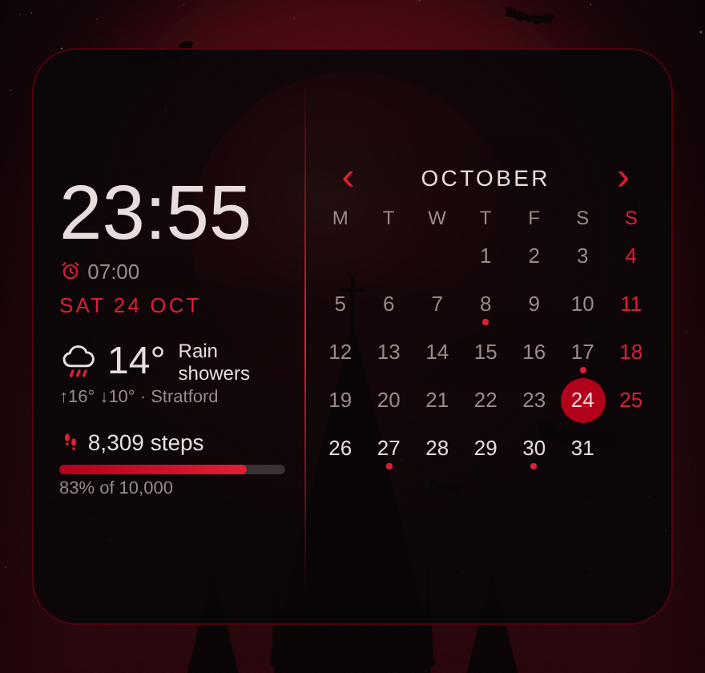

# Crimson Widget

One dark red home-screen widget that replaces separate clock, calendar, weather and step widgets.
It matches the [Gothic Crimson theme](../theme/gothic-crimson/README.md).

| Part | Shows | Tap it to |
| --- | --- | --- |
| Clock | Time, your next alarm and the date | Open the alarm list in Clock, to switch alarms on or off |
| Weather | Temperature, conditions, today's high and low | Open your Weather app |
| Galaxy Buds (only while connected) | Left and right earbud battery, and an **ANC / Ambient** switch | A mode switches to it · elsewhere on the row reconnects |
| Music | The song playing (album art, title, artist), a queue button, and shuffle, previous, play/pause, next and repeat (off → all → one) | Art or title opens the music app · queue pops up what's next (tap a song to jump to it) · play with nothing playing resumes Spotify |
| Steps | Today's steps with a red progress bar toward your goal | Open Samsung Health |
| Month calendar | This month, with today circled in red and a red dot under days that have events | **‹ ›** change month · month name goes back to this month · a day opens it in Google Calendar (or your calendar app) |

## Install

1. On your phone, open this repo's **Releases** page and download `CrimsonWidget.apk` from **Latest builds**.
2. Open the APK and install it. Android asks you to allow installs from your browser the first time.
3. Open **Crimson Widget** and set up:
   - **Weather**: search for your town, or tap **Use my location**. Then tap **Weather tap opens…** and
     pick your weather app (on Samsung phones, **Weather**).
   - **Steps**: tap **Connect steps**, and allow both **Steps** and **Access data in the background**.
     Samsung Health also has to share steps: in Samsung Health, open the menu → **Settings → Health Connect**
     and allow it to write steps.
   - **Calendar**: tap **Allow calendar** to get the event dots. The calendar works without it.
   - **Music**: tap **Allow music access** and switch Crimson Widget on. If the switch is greyed out, tap
     **Switch greyed out? Unlock it**, then **⋮ → Allow restricted settings**, and try again.
   - **Galaxy Buds**: tap **Allow Bluetooth**. If you have more than one pair, tap **Earbuds** and pick yours.
   - **Widget background**: drag the slider to make the background more see-through or more solid.
4. Tap **Add widget to home screen**. It's 6×5 by default. Long-press it to resize.

## Crimson Glance (lock screen)

A second, slim widget: one row with the weather, steps, your Buds' battery and mode (only while they're
connected; tap to switch between ANC and Ambient) and your next alarm. Add it to the lock screen from
**Settings → Lock screen and AOD → Widgets** (if your phone lists it there), or to the home screen like any
widget. It uses the same settings as the main widget, including the background slider.

## Crimson App Strip

A folder of apps in rows. Long-press the home screen → Widgets → Crimson Widget → **Crimson App Strip**.
In its setup screen, give it a short name if you like (it shows as a tag on the top-left edge), tap apps
to add them, and hold and drag them in the preview to arrange them. Spots you leave empty stay empty.
The strip shows one app per cell of its width and one row per cell of its height: resize it to anything
from 6×1 down to 1×1, or taller to show more rows, and scroll it up or down for the rows that don't fit.
The preview shows the strip at its home screen size, with those rows faded underneath. Icons come from
Crimson Icons when it's installed. To change the apps or name later, long-press the strip → **Settings**.
Each strip keeps its own apps, and the background follows the same slider as the main widget.

## Crimson Arcade

A 6×5 games widget. Long-press the home screen → Widgets → Crimson Widget → **Crimson Arcade**.

- **Panel**: the selected game, mission-control style: its cover on a holo pad in gold target-lock
  brackets, playtime over the last 14 days, its most-played rank and when you last played it, and
  **Launch**. Under it, a row of recommended
  games (your most played). **⚄** picks a random game.
- **All games**: every game A–Z, with letter tags and NEW badges for games installed this week. Scroll
  it, or tap a letter on the rail to jump.
- Tapping a game, in the grid or the recommended row, only **selects** it; nothing launches until you
  press **Launch**. Taps on empty parts of the widget do nothing.
- Playtime needs usage access (Settings → Usage access → Crimson Widget, or **◈ Enable play stats** in
  the panel); without it, the recommendations are your newest games.
- Games are found automatically from the category apps declare. Long-press → **Settings** to add any it
  missed or hide any you don't want.

## Crimson Launcher

A whole home screen in the same style, built into the Crimson Widget app. Turn it on with **Use Crimson
Launcher as home** in the app (or Settings → Apps → Default apps → Home app → Crimson Launcher). Switch
back to One UI Home the same way at any time.

- **Status bar**: the launcher hides Android's and draws its own: time, the apps with notifications,
  the battery as a ring round the camera (gold while charging, red under 15%), signal, Buds and battery.
  Inside other apps you still see Samsung's own status bar.
- **The ring**: your folders as nodes. Tap one and its apps fly out in orbit round the core (two orbits
  for more than eight). Swipe sideways or tap the chips to hop between nodes, tap the core to close.
  The first time, the nodes are built from the old home-screen folders (MAIN, AI, WORK, APPS, GOOGLE,
  SAMSUNG) plus GAMES, which fills itself with your Arcade games, most played first. Drag round the
  ring to spin it: it coasts, ticks as each node passes the top and settles on the nearest slot.
- **The core**: the old dock (WhatsApp, Messenger, Messages, Phone, Camera, Play Store, Chrome) orbits
  the centre with unread counts. The centre button searches every app. Drag round the core to spin
  the dock the same way.
- **Modes**: Morning (05:00–07:00) and Night Ops (from 17:00) put MAIN at the top of the ring; Work
  (07:00–17:00) puts WORK there and dims GAMES. Pick a different top node for each mode in Launcher
  settings. Tap the mode on the status line (◆ NIGHT OPS ▾) to switch by hand; it holds until
  the next change on the clock.
- **Crimson Weather**: tap the weather for a full forecast, laid out like Samsung Weather: now with a
  line about the day, 48 hourly cards to swipe through, conditions (feels like, humidity, wind with a
  compass, UV, rain, cloud), the sun's path, and ten days from yesterday with day and night skies.
  Tap an hour for its own page (rain amount, wind, humidity, UV, cloud and that day's graph), or a
  day for its page (day and night, a summary, hour by hour, rain total, wind, UV, sunrise and
  daylight). Swipe sideways or use ‹ › to step through them; Back returns. From Open-Meteo, for the
  city set in the app. **SAMSUNG ↗** in its corner opens Samsung Weather.
- **Around it**: weather, the date and next alarm (tap for the calendar or
  alarms), the steps line (tap for Samsung Health) and the music bar with shuffle, skip, repeat and the
  queue button.
- **Swipes**: down for the Comms Centre, up for the Hive Map, right for the Game Hub, left for the
  Command Deck.
- **Command Deck**: a live **briefing** under the clock: a CLEAR / BUSY / ALERT lamp, a headline of the
  most pressing thing, the next 12 hours as a strip (night, rain, events, alarm), and lines most urgent
  first (what's next, rain, battery, alarm, unread, focus, habits, countdowns, markets), each opening its
  place; from 19:00 it briefs on tomorrow; **⧗ Shifts** opens a weekly shift planner (your usual shift
  types, custom times, copy last week) that saves each shift to your calendar (Google by default, updated in
  place, with a reminder) and briefs you on them, including a one-tap alarm when none is set before an early
  shift; **⇪ Add all shifts** writes them all in at once; new email in the **Even Us Mailbox** and your
  personal email (counted from Gmail's notifications); BBC headlines on a ticker; **🔊 Read** talks the whole
  day through to you by name (Vee), with the news, lighting up each line as it goes; or hand it to Claude, then Ask Claude (type or speak;
  it starts a new chat in the Claude app, and your recent questions are a tap away), then the agenda; a
  full-month **calendar** of your Google (or any synced) calendars, with a dot per event in its colour:
  use ‹ TODAY › to change month, tap a day for its events and *+ Add* there; **notes**; **comms** (the apps with messages waiting, then each message with the sender's photo,
  reply and clear); vitals; audio; quick actions; a **focus** timer (15/25/50 minutes or a 5-minute break; it rings at the
  end and can silence the phone); sky (with the sun's path and the next 12 hours' rain chance when
  expanded); a **7-day forecast** as day tiles (tap a day for its weather page); **habits** (tap a day to tick it, with streaks); **countdowns** to your dates;
  **clocks** for other cities and your next alarm; links; markets, with your **holdings** for a portfolio
  total and today's move (set them on a coin's page); most used apps; Buds; power, with how long the
  battery will last or how long to full; **network** with live download and upload speeds and today's
  data; time; and systems. Tap a card's title row to expand it; **✎** rearranges the deck, turns
  sections on or off and picks the six quick actions. ⚙ opens the phone's Settings. Screen time, data and
  most-used need Usage access (tap a card to allow it).
- **Hive Map**: every app in a honeycomb that repeats for ever in every direction (no edge), in patches round tags for the dock and each node, big in the
  middle and shrinking outwards. The middle bulges big with the apps spread apart and named; a sight marks the centre and it settles onto a cell after a fling. Drag to fly round it, tap a tag in the jump bar to glide there, or
  switch to the A–Z list. Typing lights up the matches and centres the best one; Enter opens it. An app
  you don't have offers Google Play, Galaxy Store or the web instead (Enter opens Google Play).
- **Arcade (Game Hub)**: mission control for your games. Readouts for games, today, the week and your
  streak; a holo projector with your games on a shelf (most played and last played first), the selected
  one in a gold target lock; its playtime, this week and last played; **Launch** and **⚄** random; then
  every game as hex tiles with playtime bars, filtered by ALL / RECENT / MOST PLAYED / NEW / A–Z (with a
  letter rail). **Player stats** shows your level and rank, the week's playtime by day, top games and
  achievements. Tapping a game only selects it. The GAMES node opens it too. **⋮** next to Launch, or
  holding a game tile, offers Launch, Remove from Arcade, App info and **Uninstall**.
- **Jarvis**: your assistant, on the arc-reactor **orb** under the music bar (hold it to type), ◉ JARVIS on
  the briefing, or his own **Jarvis** icon (set the side key's double press to open it). Talk or type,
  and he answers out loud, typed out, with a HUD card and buttons:
  - **Your day**: "brief me", "continue from the news", "am I working tomorrow?" *and Friday?*, "what's on
    Monday?", "will it rain tomorrow?", "any emails from Even Us?", "any messages?".
  - **Doing things**: calendar events and notes, alarms ("set an alarm for my next shift"), timers,
    torch, volume, do not disturb, music, focus, habits; "call Mum" (he checks first), "WhatsApp Tom
    saying I'm on my way" (opens the chat with it typed), "text her instead", "open Spotify".
  - **Notes first**: "make a note", "add …", "remind me …" go on the deck's notes (with a *To calendar*
    button when there's a day or time in it); the calendar only when you say "…to my calendar",
    "book" or "schedule".
  - **Follow-ups, add-ons and undo**: he keeps the thread ("make it 6:30", "move it to Friday", "call
    her", "and Friday?"), adds on ("and eggs" onto the note, "and one at 7:30", "and set a timer…",
    "add that to my notes", "send that to Tom"), messages wait as drafts you can add to ("and say I'll
    bring dessert") before "send it", and **↺ Undo** (or "undo that") takes back what he just did.
  - **Hands**: switch on *Jarvis Hands* in Accessibility and he works other apps: "turn on the bedroom
    light" opens Tapo, taps its switch and comes back. "Learn the fan in SmartThings" and he watches you
    do it once, then does it himself. Idle (watching no app) until asked.
  - **Alarms, all of them** (with Hands on): "what are my alarms?" reads Samsung Clock's whole list, which are
    on and their days; "turn off my 6am alarm", "turn on all my alarms", "move my 6am alarm to 6:30".
  - **The deck by voice**: "add a habit gym and tick it off today", "untick gym", "how are my habits?",
    "add a countdown to holiday on 3 March", "I'm working Monday 7 till 3" (saved, synced to the calendar),
    "I'm off on Friday", "tick off buy milk". Also "which lights are on?" (reads Tapo) and "what's my
    screen time?".
  - **Editing anything**: "change my note from dim my laundry to do my laundry", "change the last note to …",
    "no, do my laundry" straight after a note, "replace milk with oat milk on my list", "delete buy milk from my
    notes"; "rename the gym habit to gym session"; "change my Monday shift to 8 till 4"; "move the dentist to
    Friday at 2"; "change my locker code to 9921"; "change the holiday countdown to 5 March"; "cancel the
    dentist" (he checks first). All undoable.
  - **Lights (Tapo)**: on and off by the light's own button (only when it needs it), "brighter", "dimmer",
    "lights to 30%", "full brightness", "next colour", "make the light red / blue / green / purple / warm white"
    (your presets, in order), and "brighter" or "red" again straight after.
  - **Heating (Air+)**: "turn on the heating" (or "I'm cold"), "heating off", "turn on the air con", "set it to
    28 degrees", "warmer", "turn the heat down two", and "and 24" right after. Hands open Air+, press power,
    the mode and + / − until it reads your number, then come back. "Learn the heating in Air+" if it can't
    find the buttons.
  - **"Hey Jarvis" from any app** (⚙ → Hey Jarvis; a one-off 40 MB download): a wake word heard offline by
    Vosk, then a Jarvis strip over whatever you're in that listens, answers out loud and does it. "Open
    Gallery" leaves you in Gallery; switching a light or the heater happens in Tapo / Air+ and comes back
    to Jarvis; after a colour, brightness or temperature he stays a few seconds for "next colour",
    "brighter" or "warmer", then comes back. Android's green mic dot shows while he listens; "Only while
    charging" saves the battery. Needs "Appear on top".
  - **Routines**: "good night" (do not disturb, an alarm for your next shift, tomorrow's plan),
    "good morning" (the briefing), "leaving work", "focus mode", and your own in ⚙ → Routines.
  - **Memory**: "remember my locker code is 4412" / "what's my locker code?"; "remember Tom's
    birthday is 3 March" adds a countdown; "my boss" works once he knows who that is.
  - **Speaking up**: no alarm before an early shift, rain on the way in, birthdays, the evening
    wind-down and a flat battery at bedtime, as notifications with a button and on his home button.
  - **Personality**: Butler, Witty or Brief; voice, chimes, wind-down time and more in ⚙.
  - **Notes, by number and in bulk**: "what notes do I have" reads them numbered; "tick off the second one",
    "I completed the last one", "remove the third and second notes", "tick my notes" (all of them), and
    "add a note to buy milk and eggs and another note to lock the door" (two notes). Straight after notes,
    anything unclear is asked about as a note.
  - **Habits by what you did**: "I've placed my orders", "I worked on lessons today" tick off the habit
    that fits, matched by its words, so new habits work the same.
  - **Several at once**: "close the app and lock my phone", "turn the heating on, then lock my phone".
  - **The phone**: lock it, screenshot, notifications, quick settings, recent apps, home, close the app,
    power menu, split screen (with Hands); silent, vibrate and sound on.
  - **Alarms in the Clock** (with Hands): a tidy list read in groups ("Every day: 7:05, 7:10 and 7:15");
    "turn off the 7am alarms" (just 7:00–7:59), "delete all the 7am alarms" (he asks, then long-presses,
    ticks and deletes), runs of alarms for a shift ("6 alarms 5 minutes apart").
  - **Work alarms that move with your shifts**: "set my alarms for work tomorrow" looks up the shift and
    moves the same alarms (the ones named Work in the Clock) to the right time: opening each one,
    turning the time wheels and saving it, so you never pile up new ones. On a day off he switches them
    off. The first time, he asks which of your alarms are the work ones and names them. From 8pm,
    the first time you're on the home screen, he does it for tomorrow by himself and tells you (off in
    his settings: Work alarms each evening). "Turn off my work alarms" works too.
  - **Your rota in one go**: "add shifts next week on Tuesday, Wednesday and Sunday 7 till 3" (the other
    days that week become days off), "Thursday and Friday 7 till 7", "Saturday the same", "Wednesday off";
    "what's my rota this week / next week".
  - **Uni next to your shifts**: "I got uni from 5pm to 9pm on Wednesday" (with a tap to make it every
    week), "uni every Wednesday 5 till 9", "no uni this Wednesday", "have I got uni tomorrow". It goes in
    the same calendar as your shifts, shows on the shift planner in blue and in the briefing, and he warns
    you if it overlaps a shift.
  - **Hours and pay, as your payslip does it**: basic pay plus TRONC, income tax on your code (Week 1
    basis), NI on basic pay, and your NEST pension (5% above the qualifying threshold, relief at source),
    paid fortnightly. "What have I earned this week / this month", "when's payday?", and "my pay log"
    (week by week, with paydays, to share). Each shift shows what it pays before and after tax. Change the
    details by saying them ("my basic rate is…", "tronc is about… an hour", "my tax code is…").
  - **Clocking in and out**: "I've clocked in" / "I'm starting work now" takes the exact time (or "I started
    work at 7:10"); "I've finished work" / "I clocked out at 6:15" ends the shift then. The real times are kept
    on the phone for your hours and pay (the planner shows "WORKED 07:04–18:12"), while the calendar keeps
    your rota's shift as planned. He says how it compares with the plan and what it pays.
  - **The evening before**: from 7pm before a working or uni day, one heads-up with the shift, when you're
    up and out, whether the work alarms are set, uni, the tube on your line and rain on the way.
  - **He checks his work**: after switching a Tapo light he looks again, and tries once more or tells you
    if it didn't take. "Wake log" shows why he woke when he heard his name.
  - **His brain (optional, on the phone)**: Google's Gemma 3n E4B (free; a one-off 4.4 GB download, loaded
    in his settings under Jarvis Brain), run on the phone with Google's MediaPipe. When his own rules don't
    know a request, the brain works out which of his commands you meant; he does it and learns the
    phrasing, so next time he knows it without the brain. Anything else it answers, knowing your routine.
    Nothing you ask leaves the phone.
  - **Look-ups**: "look up …", or a question about something that changes (news, opening times, prices):
    he searches the web, reads the top pages and puts what they say in two or three sentences on a card,
    with the sources (shown, not read out). Without the brain, the top results.
  - **Maths**: "what's 12 times 7", "15% of 80", "square root of 144", "add 5 and 7", brackets and powers;
    "times 2" carries on from the last answer.
  - **Rules he keeps**: "the 7pm alarm always stays on", "never turn off the hallway light". Anything that
    would switch one off asks you first.
  - **Teach him how you do things**: "I need to wake up at 5 to start work at 7, I set 6 alarms 5 minutes
    apart and I leave at 6:15", "on Thursdays I take the Elizabeth line". He repeats it back and acts on it.
  - **The tube**: "any delays tomorrow?", "and the Central?", in the briefing, and a heads-up timed off
    your shifts when your line's in trouble.
  - **Heating**: Air+ hides its numbers, so he keeps track of the setting, turns the wheel by position,
    and learns from "it's on 22" or "you went down by one".
  - **Questions he can't answer**: he offers to Google it in Chrome or ask Claude; "Google…", "look up…"
    and "ask Claude…" go straight there.
  - **He learns**: your phrasing (a "yes" to "did you mean…" teaches him), your usual requests at each
    time of day, which apps you use when (never while a VPN is on; off in ⚙), and his voice grows more
    familiar the longer you have him. "What do you know about me" lists it all.
  - **One conversation**: what you say with Hey Jarvis shows in his panel too; tap the Hey Jarvis strip to
    open him. Say "stop" while he talks to cut in. "Send me the hands log" shares what he saw when an app
    didn't go to plan.
  Speech is recognised by Google's online recogniser when you're online (on the phone when you're not or
  it's locked); everything he learns stays on the phone.
- **Messages on the home screen** slide up into the space under the music bar: tap to open, REPLY to
  answer in the Comms Centre, or swipe it down to dismiss it (it stays in the Comms Centre).
- **Comms Centre**: Samsung's quick controls and your notifications in one panel: twelve toggles (Wi-Fi,
  Bluetooth, mobile data, sound, rotate, torch, Do Not Disturb, location, power saving, airplane, Buds,
  and ⋯ for Samsung's own panel), brightness and volume, the music card with its output device, Smart
  View, SmartThings, Quick Share and media output shortcuts, then the notifications to open, reply to
  inline or swipe away; ⌄ (or hold) opens a notification up: the whole message, its picture, the
  conversation and the app's other notifications. Toggles marked ↗ open Android's own switch, since only the system can flip
  those. A swipe from the very top edge still opens Samsung's panel; that gesture belongs to Android.
- **Crimson Comms in any app**: the app list has a **Crimson Comms** shortcut. Add it to Samsung's
  Edge Panel (Apps panel → edit → add) and the Comms Centre opens over whatever app you're in; swipe
  up or press Back to return. There's also a glowing **Comms handle** in the middle of the right edge
  over every app: swipe it in or tap it for the same thing. Move it, switch sides or turn it off in
  Launcher settings.
- **Edge lighting** (needs "Display over other apps"): twin strips race round the screen edge in the
  app's colour when a message arrives, two comets circle it during an incoming call, gold energy climbs
  it when the charger goes in, and it breathes red on low battery. Works over any app while the phone
  is unlocked; Samsung's own edge lighting still handles the lock screen.
- **Animations**: a boot sequence each unlock (scan line, rings spinning in, nodes popping out, the dock
  flying out of the core), embers, a radar sweep and breathing nodes while idle, a shockwave and
  hologram flicker when a node deploys, target-lock brackets when an app opens, radar pings for new
  messages, a mode-shift sweep, the music visualiser and a spark along the steps line once the goal is
  hit. Turn the boot sequence or idle effects off in Launcher settings (⚙ in the Comms Centre).
- **Themes**: 16 in Launcher settings: Crimson, Blood Moon, Mark 42, Inferno, Rose Gold, Solar, Toxic,
  Venom, Matrix, Arctic, Jarvis, Cobalt, Ultraviolet, Synthwave, Phantom and Stealth. Each recolours the
  launcher, Comms, the Hive, Game Hub, Crimson Weather, edge lighting, the handle and the Crimson icons,
  with its own strength, brightness and second accent; other apps' own colours stay as they are. The
  home-screen widgets (Crimson, strip, glance and Arcade) and the app's own screens follow it too.
- **Crimson Reactor wallpaper** (in the Crimson Live app): matches the theme and reacts to the launcher:
  message shockwaves in the app's colour, calls, taps, opening a node and the time-of-day mode.
- **Battery**: idle effects run at 20 fps and rest after 40 seconds untouched (the next touch wakes
  them), and switch off while Android's power saving is on. The Comms handle only redraws under a
  finger, the phone's readings are taken every 5 seconds (every second only while music plays), the
  weather page's sky rests 20 seconds after the last touch, and the background refresh only fetches
  weather every half hour and when there's a connection.
- **Editing**: hold a node to rename it, drag its apps into order, add or remove apps, move it round the
  ring or delete it. Hold an app in orbit to move it to another node. Hold an empty spot for a new
  node, the dock, or the wallpaper.
- Notifications, unread counts and the music bar need notification access (the same switch the
  widget's music row uses). Brightness and rotation ask for permission to change settings the first
  time.

## Good to know

- The clock and date update live. Weather and steps refresh every 15 minutes, the most often Android allows.
  Opening the Crimson Widget app also refreshes them.
- Samsung Health sends steps to Health Connect in batches, so the count can be a few minutes behind the Samsung Health app.
- The Buds row talks to the buds over Bluetooth directly. If it stays on "Connecting…", force-stop the Galaxy Wearable app (it can hold the link) and tap the row.
  If the row says "tap to connect" and tapping doesn't help, the Galaxy Wearable app may be holding the
  connection: close it and tap again.
- Tapping a gap in the widget does nothing, so a near-miss won't open anything.
- The clock follows your phone's 12- or 24-hour setting, and weeks start on the day your phone's region uses (Monday in the UK).
- Home-screen widgets can't be swiped sideways, because the home screen uses that swipe to change pages. That's why the calendar uses arrows.
- Weather comes from [Open-Meteo](https://open-meteo.com), which is free and needs no account.
