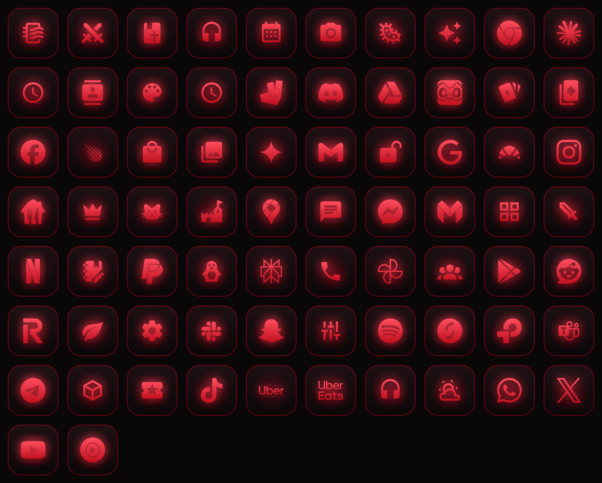

# Crimson Icons

A red-on-black icon pack that matches the [Crimson Widget](../dashboard/README.md): dark tiles, a crimson rim
and a glowing crimson symbol for each app. Apps without their own icon get their normal icon on the same
dark tile, so nothing looks out of place.



## Install and apply (Samsung Galaxy)

1. Download `CrimsonIcons.apk` from this repo's **Releases → Latest builds** and install it.
2. Install **Good Lock** from the Galaxy Store, open it, and install the **Theme Park** module from its list.
3. Open **Theme Park**, go to the **Icon** tab, and choose **Crimson Icons** from the icon packs.
   (You can also open **Crimson Icons** and tap **Open Good Lock to apply**.)
4. Tap **Apply**. Your home screen and app drawer switch to the Crimson icons.

To go back, open **Theme Park → Icon** and remove or switch the icon pack, or pick another icon theme in
**Settings → Themes**.

## Icons for more apps

Open **Crimson Icons** to see which of your apps don't have a Crimson icon yet. Tap
**Copy list of apps without an icon** and paste it into a chat with Claude to get them added.

## How it's made

The icons are generated, not hand-drawn. `tools/icons.js` lists every icon: its symbol (from
[Simple Icons](https://simpleicons.org), CC0, or [Material Design Icons](https://pictogrammers.com/library/mdi/),
Apache 2.0) and the app components it replaces. To change or add icons:

```
cd icons/tools
npm install
node generate.js
```

This renders the PNGs into `src/main/res/drawable-nodpi` and rewrites `appfilter.xml` and `drawable.xml`.
It needs Playwright with Chromium.
