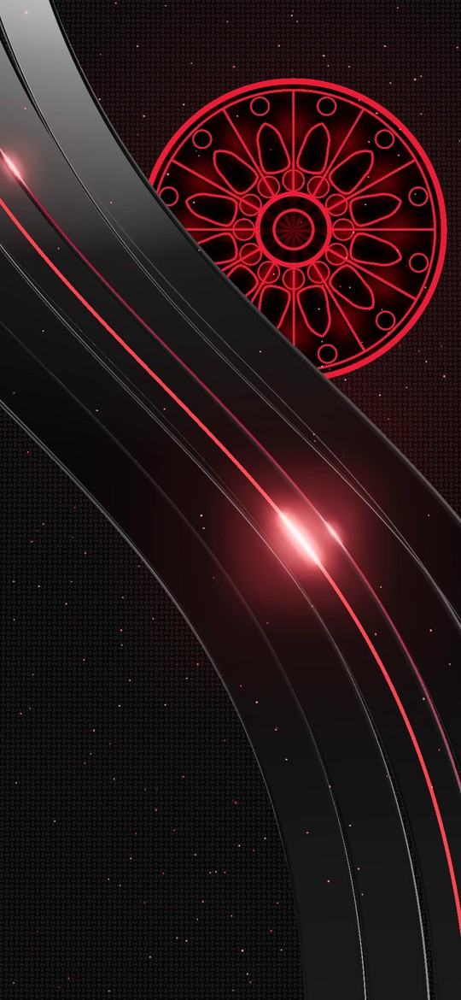
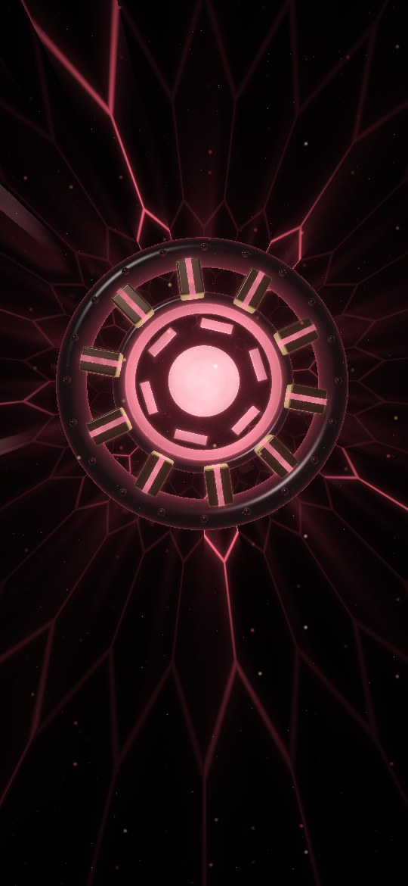

# Crimson Live

An animated 3D live wallpaper in the Gothic Crimson style: a stained-glass rose window glowing and slowly
turning on a carbon-fibre wall, glossy black bands rippling in front of it, pulses of light racing along a
crimson neon line, and embers drifting up through the scene.



## Install

1. Download `CrimsonLive.apk` from this repo's **Releases → Latest builds** and install it.
2. Open **Crimson Live** and tap **Set as wallpaper**.
3. Choose **Home screen** or **Home and lock screens**.

Tilt your phone and the scene moves with real depth: the glossy bands slide across the rose window behind
them. The **Tilt effect** slider in the app sets how strong that is, or turns it off. Swiping between home
screen pages pans it slightly too.

It's a 12-second seamless loop played by the phone's video hardware. Video, drawing and the motion sensor
all stop whenever the wallpaper is hidden (apps open, screen off), so it only uses power while you can see it.

## Crimson Reactor

The app has a second wallpaper, drawn live on the GPU: a 3D arc reactor (dark metal housing, bolts, copper
coils, a counter-spinning ring and a swirling white-hot core) floating in front of an endless hex tunnel
that rushes towards you, with data pulses, warp streaks and drifting embers. Tap **Set Crimson Reactor
(3D)** in the app.



- It tilts in 3D with the phone, and powers up with a scan line each time you unlock.
- Charging: a surge rolls out when you plug in, the walls fill with white-gold energy up to your
  battery level as bands keep rising, the core beats, and a gauge round the reactor shows the level.
  Low battery makes it beat slowly in red.
- With **Crimson Launcher** as your home screen it matches the launcher's theme and reacts: a shockwave in
  the app's colour for each message, the reactor spinning up with orbiting comets for an incoming call, a
  pulse when you open a node, a ripple where you tap, and calmer or livelier with the time-of-day mode.
- Battery: it's drawn at under half the screen's resolution and scaled up, runs at a steady 30 fps (20
  in power saving) with slow, calm motion, and stops completely while hidden.

The shader is `src/main/res/raw/reactor.frag`.

## How it's made

The animation is rendered offline in 3D with three.js, so it can use effects a phone couldn't run live all
day: glossy reflections, bloom and hundreds of particles. The scene is
[`theme/gothic-crimson/src/3d/live.html`](../theme/gothic-crimson/src/3d/live.html). Every motion repeats
exactly every 12 seconds, so the last frame joins the first with no jump.

Each frame is rendered as three layers, packed side by side into one 3240×2340 video: the background (wall
and rose window), the foreground (bands, neon and embers over black) and a mask of the bands. The scene is
rendered 12% larger than the screen. On the phone, `LayerRenderer` splits the layers apart with OpenGL and
stacks them, shifting the foreground about three times as far as the background as the phone tilts.

To re-render the video (needs Node, Playwright with Chromium, and ffmpeg):

```
cd theme/gothic-crimson/src/3d
npm install
node render-live.js            # writes live/src/main/res/raw/crimson_live.mp4
node render-live.js --preview  # just four stills, for checking changes quickly
```
