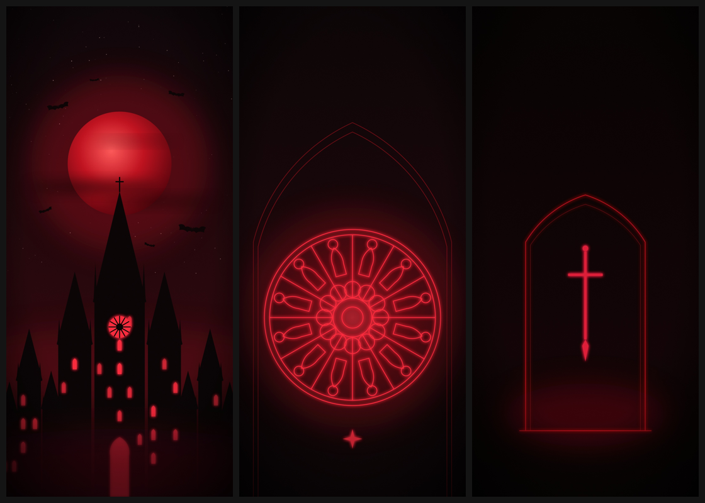

# Gothic Crimson — a dark red theme for the Galaxy S26 Ultra



Near-black backgrounds, blood-red accents, cathedral spires and rose windows.

## What's here

| File | Use it for |
| --- | --- |
| `wallpapers/gothic-crimson-cathedral.jpg` | Home screen: blood moon over a cathedral skyline |
| `wallpapers/gothic-crimson-rose-window.jpg` | Lock screen: glowing rose window, with space at the top for the clock |
| `wallpapers/gothic-crimson-void.jpg` | Almost pure black with one glowing arch. Easy on the battery with the AMOLED screen |

The wallpapers are 1440×3120, the S26 Ultra's full QHD+ resolution, so they show pixel for pixel. In **Settings → Display → Screen resolution**, pick **QHD+** to get the sharpest picture.

## Colour palette

| Role | Hex |
| --- | --- |
| Background (void) | `#0A0708` |
| Surface (crypt) | `#140C0F` |
| Raised surface (ash) | `#1E1416` |
| Primary (blood red) | `#B3001B` |
| Accent (crimson) | `#E01E37` |
| Highlight (ember) | `#FF4D5E` |
| Main text (bone) | `#E8DCDC` |
| Secondary text (dust) | `#9A8A8C` |

## Install it on your phone

### 1. Wallpapers
1. On your phone, open each `.jpg` in the `wallpapers` folder on GitHub and download it (open it, then tap **⋯ → Download** or long-press the image).
2. Go to **Settings → Wallpaper and style → Change wallpapers → Gallery**.
3. Set **cathedral** as the home screen and **rose window** as the lock screen.

### 2. Dark mode
**Settings → Display → Dark**.

### 3. The full red theme (system colours, quick panel, keyboard, icons)
Samsung's free **Good Lock** app has a **Theme Park** module that builds a real system theme.

1. Install **Good Lock** from the Galaxy Store, then install **Theme Park** from inside it.
2. Open Theme Park, choose **Theme → Create new**, and pick `gothic-crimson-cathedral.jpg`.
3. Tap the colour circles and type in the palette above:
   - Main/accent colour: `#B3001B`
   - Background: `#0A0708`
   - Text: `#E8DCDC`
4. Switch on **Dark mode** in the theme options, then tap **Apply**.
5. **Icons**: in Theme Park, go to **Icon → Create new**. Use background `#140C0F` and icon colour `#E01E37`.
6. **Quick panel**: in Theme Park, go to **Quick panel**. Use background `#140C0F` (around 80% opacity) and active buttons `#B3001B`.
7. Optional: in the **Keyboard** tab, pick black keys with `#E01E37` for the key text.

For the full set (quick panel image, keyboard, volume panel and the Crimson icon pack) follow
[theme-park/README.md](theme-park/README.md).

### 4. Always On Display (optional)
**Settings → Lock screen and AOD → Always On Display**. Pick a thin clock style and set its colour to `#E01E37`.

## Change the wallpapers

The wallpapers are drawn in code, in `src/wallpapers.js`. Edit the colours or shapes there, then run this from the repository root:

```
node theme/gothic-crimson/src/render.js
```

This needs Node and Playwright (`npm i playwright`).
